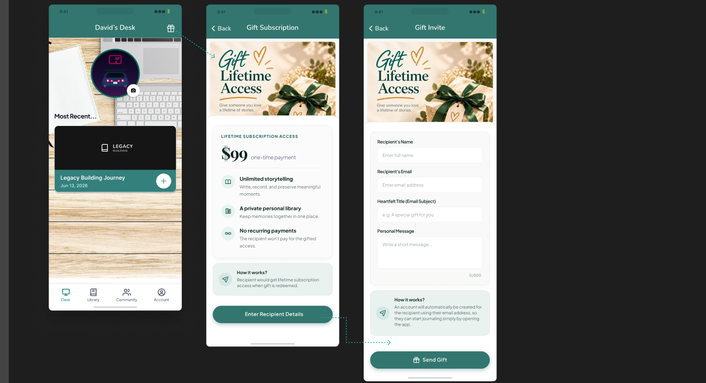
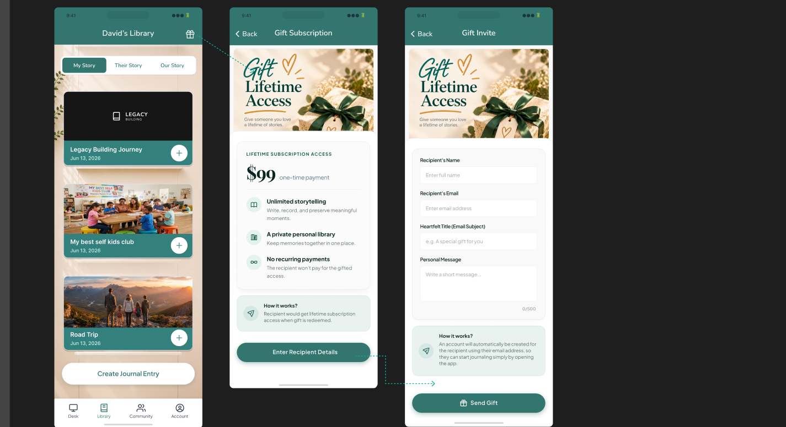
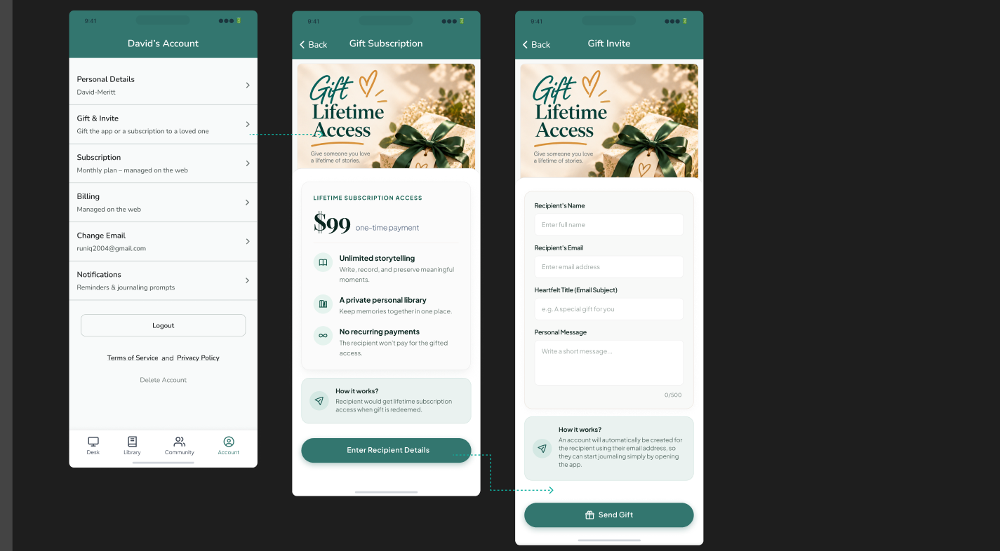
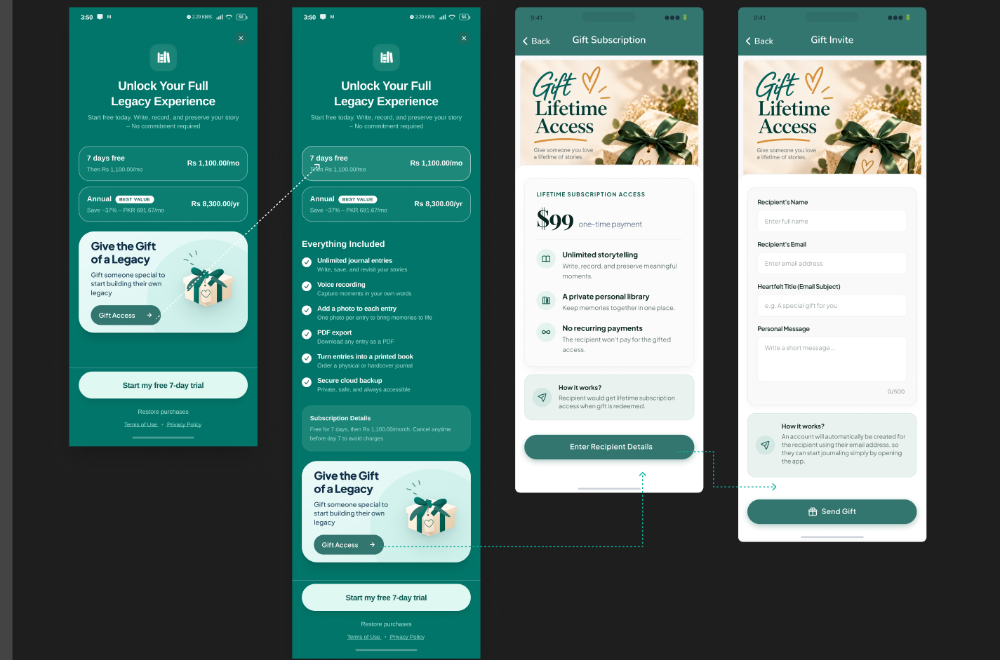
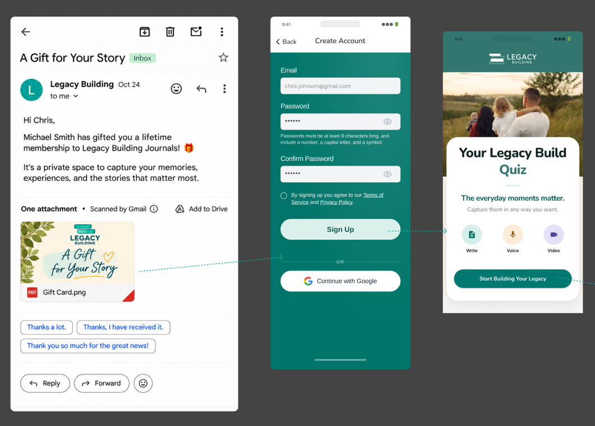
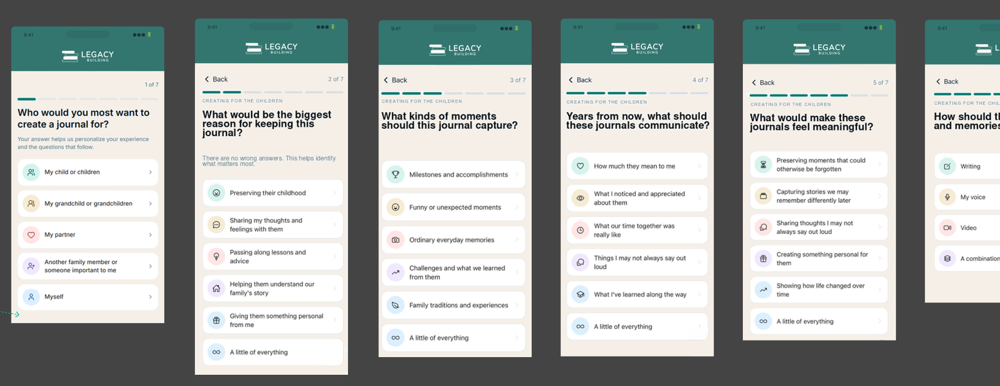
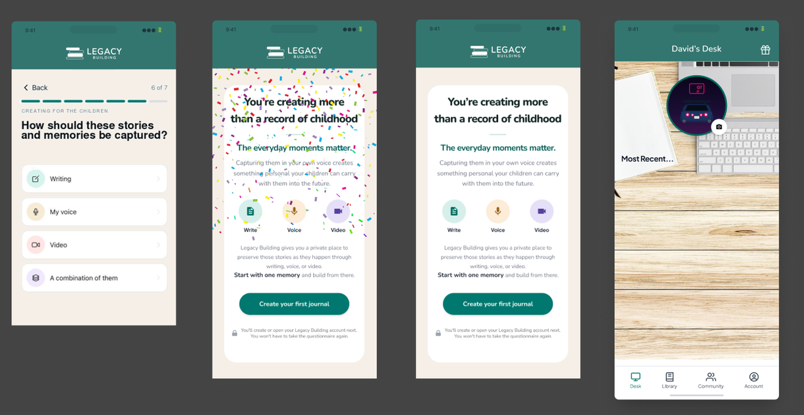

# Gift Lifetime Access

Platforms: native app (iOS, Android) and web. **Web mobile view = Figma exactly. Web desktop = existing desktop dashboard conventions.**
**First feature to implement.** Payment involved. PM tasks: [gift-tasks.md](gift-tasks.md) (SST-1 to SST-10).

## Summary

Any signed-in user (subscriber or not) pays a one-time amount to gift **lifetime access** to one recipient email.
Lifetime access means the recipient uses the full app with no subscription, ever. **Gifting is lifetime-only**: any design
copy mentioning "a subscription" stays as is (the client won't change it) but doesn't mean monthly or annual gifts.

After confirmed payment, the **purchaser** (not the recipient) gets an email with a receipt, the **PNG gift card** attached,
and a **Claim My Gift** link. The purchaser forwards, shares or prints the card whenever they like. **Nothing is sent to the
recipient automatically.** The card's QR code and the link **always open the web app** (even if the recipient has the
mobile app installed). There the recipient signs in, or creates their account with the email greyed out, and redeems. New
accounts then go through the onboarding quiz on web.

## Visuals

### Entry point (Desk) → Gift Subscription → Gift Invite

- **Desk** header ("David's Desk") gets a **gift icon** at the top right that opens Gift Subscription.
- **Gift Subscription** screen (back + title): hero "Gift Lifetime Access / Give someone you love a lifetime of stories." A card labelled "LIFETIME SUBSCRIPTION ACCESS" shows **$99 one-time payment** (the real price is the regional price), then three features: "Unlimited storytelling / Write, record, and preserve meaningful moments.", "A private personal library / Keep memories together in one place.", "No recurring payments / The recipient won't pay for the gifted access." An info box "How it works? / Recipient would get lifetime subscription access when gift is redeemed." Primary button **Enter Recipient Details**.
- **Gift Invite** screen: the same hero, then a form with **Recipient's Name**, **Recipient's Email**, **Heartfelt Title (Email Subject)** (placeholder "e.g. A special gift for you") and **Personal Message** (500-character counter). Info box: "How it works? / An account will automatically be created for the recipient using their email address, so they can start journaling simply by opening the app." Primary button **Send Gift** (gift icon). The info box copy stays as designed, although the account is actually created only when the recipient sets a password (decision 5).

### Other entry points

- **Library** header: the same gift icon.
- **Account**: a new row **"Gift & Invite / Gift the app or a subscription to a loved one"** between Personal Details and Subscription. This section also holds the purchaser's **gift history** (decision 14).
- **Paywall** ("Unlock Your Full Legacy Experience", both the collapsed and the expanded "Everything Included" versions): a card **"Give the Gift of a Legacy / Gift someone special to start building their own legacy"** with a **Gift Access →** button that goes to Gift Subscription.

### Recipient: email → account → quiz → desk

- **Gift email**: the Figma email is shown as received by the recipient. Because the purchaser receives it and forwards it, write it so it reads well when forwarded. Subject = the purchaser's Heartfelt Title (Figma example "A Gift for Your Story"). The body uses the Figma copy ("Hi Chris, Michael Smith has gifted you a lifetime membership…") plus a **Claim My Gift** link, followed by a separate receipt block for the purchaser. Attachment: **Gift Card.png** (final card template and assets to come from the client; a placeholder card with the QR is used until then).
- **Create Account** (new user): email pre-filled and **locked**, Password, Confirm Password, terms checkbox, **Sign Up**, or **Continue with Google**.
- **Quiz**: the existing onboarding quiz (`convex/onboarding/questions.ts`, native `components/welcome/*`, web `features/welcome/*`), unchanged. It ends with "Create your first journal" → Desk.

## Decisions

| # | Topic | Decision |
|---|---|---|
| 1 | Price | One base price (USD). Mobile: store-localised price (PKR, etc.). Web: Stripe **Adaptive Pricing** (automatic currency conversion at checkout). **No separate per-region price list.** |
| 2 | Payment rails | Web: Stripe Embedded Checkout (cards, Apple Pay and Google Pay wallets). Mobile: store in-app product through RevenueCat (C1). |
| 3 | Who can gift | Signed-in users only (subscriber or not). No public purchase. |
| 3a | Who gets the email | **Only the purchaser**: receipt + gift card PNG + Claim My Gift link (SST-6). The purchaser forwards it themselves. No automatic recipient email. |
| 3b | Where QR/link opens | **Always the web app** (`/gift/<token>`), never the native app. Redemption and new-account creation happen on web only. |
| 4 | Refunds | Common practice, adopted as the assumption: refund **before redemption** voids the gift (the QR stops working). Refund or chargeback **after redemption** revokes the lifetime access (Apple and Google send refund events via RevenueCat; Stripe via `charge.refunded` / `charge.dispute.created`). |
| 5 | Account creation | **Never without consent, and only on web.** The redeem page's sign-up form shows the gift's email **greyed out**. The recipient sets and confirms a password (or uses Google with the same email). Clerk verifies the email with a code, then the gift is claimed onto the new account. |
| 6 | Redemption trigger | The QR code **or** the Claim My Gift link opens `/gift/<token>` on web → sign in or create account if needed → **Claim My Gift**. |
| 7 | Existing users | Same flow: open the link → sign in (if needed) → claim. No duplicate account. |
| 7a | Email match | The signed-in account's email must equal the gift's email. Otherwise show "This gift was sent to c•••@gmail.com" with a sign-out / switch-account action. |
| 8 | Recipient already subscribed | Allowed. On redemption, a **Stripe** subscription is cancelled automatically (at period end, so there are no further charges). An **App Store / Play Store** subscription can't be cancelled by us, so the user sees an explanatory **splash screen** (web after redeem, and native on next open) telling them to cancel it in the store, with a button to the store's subscription page. |
| 9 | Already lifetime | Block the purchase if the recipient email already has lifetime access (checked again at redemption). |
| 10 | Expiry | Unredeemed gifts expire **12 months** after purchase (confirmed by the PM). |
| 11 | After redemption | Lifetime access is bound to the **account** (Clerk id), so it survives email changes. |
| 12 | Email attachment | A PNG gift card with the QR **and** the Claim My Gift link. Template and assets to come; use a placeholder until then. |
| 13 | Format | **PNG** (not PDF). |
| 14 | History | Purchasers see their gift history (recipient, date, status: pending / redeemed / expired / refunded, download PNG) **inside the Gift & Invite section** of the Account tab. No separate screen. It may be removed later if the client rejects it. |
| 15 | Quantity | One gift per checkout. |
| 16 | Scope | Lifetime access only. |
| 17 | Onboarding | The same quiz, shown only for **new** users arriving through the gift redeem page or the shared-journal acceptance page. The intro uses the SST-8 copy **"Let's personalize your legacy build."** |
| 18 | Admin | Full gifting analytics in the admin web app, mobile-responsive (no native admin). |
| 19 | Gift flow screens | Follow Figma: two screens (Gift Subscription → Enter Recipient Details → Gift Invite). |

## SST conflicts: resolved 2026-11-09

| ID | Topic | Resolution |
|---|---|---|
| C1 | Mobile payment rails | In-app store product through RevenueCat (store-localised price). Web uses Stripe. "WeniCard" is dropped (PM's mistake). |
| C2 | Link vs QR | Both: the gift card PNG carries the QR, and the email and card carry a Claim My Gift link. Same `/gift/<token>` page. |
| C3 | Public purchase | Not supported. Login required. |
| C4 | One page vs two | Follow Figma (two screens). |
| C5 | Onboarding copy | Use the SST-8 copy "Let's personalize your legacy build." |
| C6 | Account provisioning | The account is created on **web**, on the redeem page, with the email greyed out, when the recipient sets a password. Nothing is created at purchase time. |
| C7 | Admin on mobile | The admin web app is mobile-responsive. There's no native admin. |

## Confirmed 2026-11-10

- Gifting to your **own email** is blocked (`SELF_GIFT`).
- The purchaser can **resend** the gift email from the history (paid, unclaimed gifts; once a minute). The recipient email can't be changed (support).
- **Account deletion:** keep purchase records and remove personal details (see `gifts/helpers.ts#scrubGiftsForDeletedUser`).
- **Admin analytics:** as listed in SST-9.
- **Card print size:** 4×6 in at 300 dpi (1200×1800 px PNG), the client's template with text, QR and link drawn on it.

## Open (outside the code)

- Mobile payment testing (store product `lifetime_gift` + RevenueCat + a store/dev build).
- Sandbox-only web checkout from the phone: not requested; payments are tested on web.

## Implementation (as built, uncommitted as of 2026-11-09)

Full remaining-work checklist: [gift-tasks.md](gift-tasks.md#remaining-work-for-gifting-keep-this-list-current).

### Backend (`packages/backend/convex`)
- `schema.ts`: `gifts` table (purchaser*, recipient* (email lower-cased), title, message, `status` pending_payment | paid | redeemed | refunded (expired = computed from `expiresAt`), `provider` stripe | app_store | play_store, `providerRef` (Stripe PaymentIntent id / store transaction id; idempotency key), amountMinor, currency, `redeemToken`, paidAt, expiresAt, cardImageId, storeCheckoutStartedAt, purchaserEmailSentAt, redeemedBy/At, refundedAt). Indexes: by_purchaser, by_recipient_email, by_redeem_token, by_provider_ref, by_status. Plus `users.lifetimeAccess?: { giftId, grantedAt }`.
- `gifts/helpers.ts`: price constants (`GIFT_BASE_PRICE_MINOR` 9900 USD), `GIFT_STORE_PRODUCT_ID = "lifetime_gift"`, 12-month validity, redeem URL (`WEB_APP_URL` → `APP_URL` → prod default), email helpers, display status.
- `gifts/giftCard.ts` (node): renders the card. The client template is embedded in `gifts/cardTemplate.ts` (generated, 1200×1800 JPEG), with Nunito from `@legacy-building/pdf/fonts/*`, drawn by `@resvg/resvg-js` (a Convex external package in `convex.json`; fonts written to the temp dir at runtime). Test: `gifts/giftCard.test.ts`.
- `gifts/mutations.ts`: `saveDraft` (validation, no self-gift, no lifetime recipients), `startStoreCheckout`, `redeem` (token, email match, expiry, single use; grants lifetime; schedules Stripe cancel; returns `storeSubscriptionToCancel`), internal `fulfillPaid` (idempotent, schedules the email), `markRefunded`, `setCardImage`, `claim/releasePurchaserEmailSend`, `claimResend` (60 s cooldown). `gifts/helpers.ts#scrubGiftsForDeletedUser` is called from `user/mutations.ts` account deletion.
- `gifts/queries.ts`: `getOffer`, `getDraft`, `listMine` (history + card URL), `getRedeemInfo` (public, by token), `myLifetimeStatus`, internal `findStoreCheckoutGift`, `getForDelivery`.
- `gifts/actions.ts` (Node): `createCheckout` (Stripe Elements checkout, `mode: payment`, `adaptive_pricing`, metadata `kind: lifetime_gift`), `fulfillStripeSession` (webhook), `confirmCheckout` (return-page check), `confirmStorePurchase` (RevenueCat REST verification), `fulfillStoreGiftFromWebhook`, `deliverPurchaserEmail` (real card via `gifts/giftCard.ts` + Resend email with receipt and link), `resendPurchaserEmail`, `cancelStripeSubscriptionForLifetime`.
- `http.ts`: Stripe events `checkout.session.completed`, `checkout.session.async_payment_succeeded`, `charge.refunded`, `charge.dispute.created`. RevenueCat: gift-product events are routed to gifts and kept out of the subscriptions table.
- `stripe/access.ts` + `subscriptions/queries.ts#getEntitlement`: lifetime grants access (`isLifetime: true`).
- `onboarding/copy.ts`: `RECIPIENT_INTRO_HEADING`.
- `admin/queries.ts`: `giftInsights`, `listGifts` (SST-9). `admin/billing.ts` + `admin/helpers.ts`: lifetime counts as access, `lifetimeAccess` on the user summary.
- Tests: `gifts/mutations.test.ts` (12) + `gifts/giftCard.test.ts` (2); all 124 backend tests pass.

### Web (`apps/web/src`)
- Routes: `/dashboard/gift` (offer), `/dashboard/gift/details` (form, `?giftId=` restores the draft), `/dashboard/gift/checkout`, `/dashboard/gift/success`, public `/gift/$token` (redeem). Paths are in `lib/routes.ts`.
- `features/gift/*` pages; `components/gift/*` (`GiftPageChrome`/hero/how-it-works, `GiftHistorySection` in Account, `StoreSubscriptionSplash`, `PendingGiftRedirect` in `__root.tsx`).
- Paywall card `components/gift/GiftLegacyCard.tsx` in `JournalPaywallDialog` and the billing page (`BillingSubscribePanel`). Hero artwork: `packages/assets/images/gift-hero.jpg` and `gift-redeem-hero.jpg` (`assets.giftHero` / `giftRedeemHero`). Resend button in `GiftHistorySection`.
- Edited: `DashboardHeader` (gift icon on Desk/Library), `DashboardAccountPage` (Gift & Invite + "Lifetime Access" plan card), `sign-up-form.tsx` (`lockedEmail`), `CheckoutPaymentForm.tsx` (`allowWallets`), `onboarding-intro.tsx` + `welcome-onboarding.tsx` (recipient heading).

### Native (`apps/native`)
- `app/gift/index.tsx` (offer + gift history), `app/gift/details.tsx` (form → draft → RevenueCat `lifetime_gift` purchase → server verification).
- `components/gift/*` (hero image, buttons, header gift button, `LifetimeStoreNotice`, `gift-legacy-card` on the paywall), `lib/billing/gift.ts`, `lib/gift/schemas.ts`. Resend button in the gift history.
- Library (SST-10): `app/(tabs)/library.tsx` draws `assets/images/LibraryBackground.png` (new Figma artwork) behind the list; per-card `ShelfLedge` removed (the shelves are in the artwork).
- Edited: Desk/Library headers (gift button), Account ("Gift & Invite" row), `_layout.tsx` (stack screens), `dashboard-screen-header.tsx` (`right` slot).

### Admin
- `apps/admin/src/routes/_admin/gifts.tsx` (nav "Gifts"): stat cards, revenue by currency, purchases by platform, last 12 months, paginated table with status filter and exact-email search. "Lifetime" badge in the users/subscriptions tables and user detail.

### Not built
Native share sheet for the card (it opens in the browser, where it can be saved).
