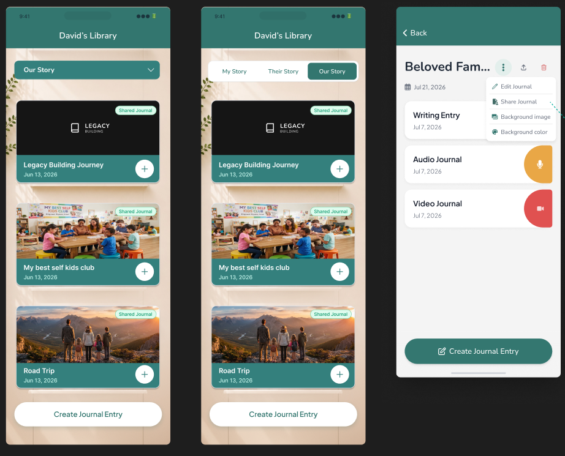
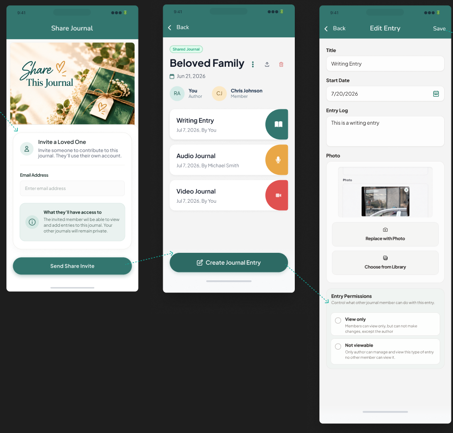
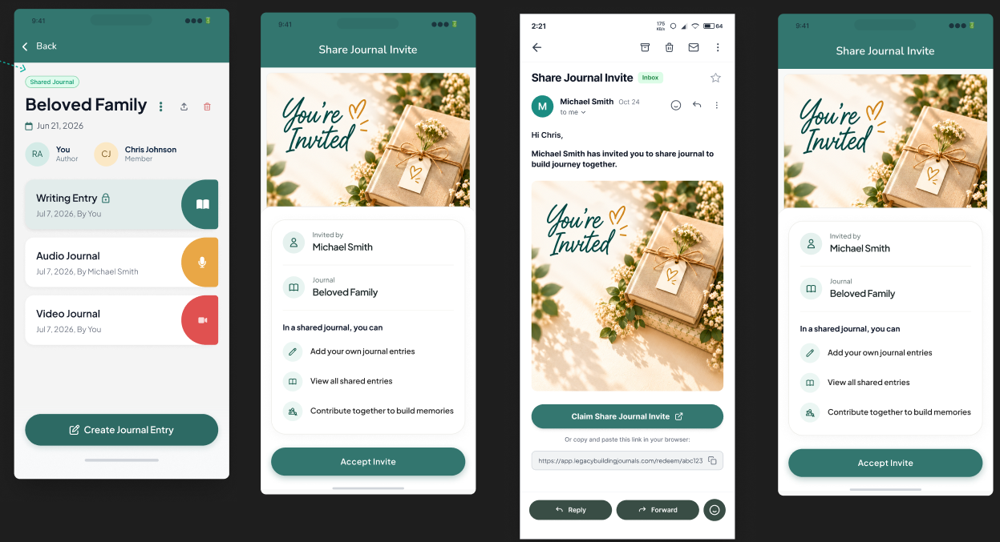

# Journal Sharing ("Our Story")

Platforms: native app and web. **Web mobile view = Figma exactly; web desktop = existing desktop dashboard conventions** (web designs not final).
Implemented **after** Gift Lifetime Access. **Status (2026-11-10): code complete on web, native and backend; not yet pushed or tested in the cloud.** See "As built" at the end.

## Summary

The author (creator) of a journal can share it with exactly one other person by email. Once the invite is claimed,
the share is bound to the member's account (Clerk id), not their email, so email changes don't break it. Shared journals
live in a new **Our Story** tab. Both people can add entries, and each entry can be made "Not viewable" so the other person
sees only its title with a lock.

## Visuals

### Library tab + journal menu

- Library header "David's Library". Use the **segmented tabs** version: `My Story | Their Story | Our Story` (the same control as the current app). Do not use the dropdown variant.
- Journal cards in Our Story show a green **"Shared Journal"** pill at the top right of the cover, and the existing `+` button and "Create Journal Entry" CTA.
- The journal detail ⋮ menu has: Edit Journal, **Share Journal** (new), Background image, Background color. The header also has export (share icon) and delete (red trash).

### Share form, shared journal, entry permissions

- **Share Journal** screen: hero image "Share This Journal". Card "Invite a Loved One / Invite someone to contribute to this journal. They'll use their own account.", an **Email Address** field, an info box "What they'll have access to / The invited member will be able to view and add entries to this journal. Your other journals will remain private." Primary button **Send Share Invite**.
- **Shared journal detail**: a "Shared Journal" pill above the title. A people row with an initials avatar + name + role: `RA You · Author`, `CJ Chris Johnson · Member` (initials avatars, as designed). Entry rows show `date, By You` / `date, By Michael Smith`.
- **Edit Entry → Entry Permissions** card: "Control what other journal member can do with this entry." Two radio options:
  - **View only**: "Members can view only, but can not make changes, except the author"
  - **Not viewable**: "Only author can manage and view this type of entry no other member can view it." ("Author" here means the journal's creator.)

### Locked entry, invite popup, invite email

- An entry hidden from the viewer shows its **title only** with a 🔒 next to it, on a tinted row. It cannot be opened.
- **Share Journal Invite** popup: hero "You're Invited". Card rows "Invited by · Michael Smith" and "Journal · Beloved Family". A list "In a shared journal, you can: Add your own journal entries / View all shared entries / Contribute together to build memories". The only button is **Accept Invite** (no decline).
- **Invite email** (new users only): subject "Share Journal Invite", body "Hi Chris, Michael Smith has invited you to share journal to build journey together.", hero image, button **Claim Share Journal Invite**, and a fallback link `https://app.legacybuildingjournals.com/redeem/<token>` (final path TBD, see below).

## Agreed behaviour

| # | Topic | Decision |
|---|---|---|
| 1 | Tab placement | A journal moves to **Our Story** for both people once shared, and returns to its original tab (My/Their Story) if the share ends. |
| 2 | Creating in Our Story | Not possible directly. Journals only reach Our Story by being shared. |
| 3 | Tab control | Segmented tabs, as in the current app. |
| 4 | Desk | Shared journals appear in the member's Desk "Most Recent". |
| 5 | One member max | A pending invite takes the single slot. The author can cancel it, which frees the slot. |
| 6 | Leave / remove | The member can **leave** and the author can **remove** the member. Either way, the member's entries are **deleted** from the journal and it returns to the author's original tab. |
| 7 | Expiry | Invites expire after 30 days. |
| 8 | Existing account | **No email.** They get the shared journal through the in-app popup (#10), on mobile or web. |
| 8 | No account | A custom invite email (see Email delivery) links to the claim flow. The invitee signs up, then claims. |
| 9 | Who can claim | Only a signed-in account whose **verified email matches** the invite. After claiming, the share is bound to the member's Clerk id. |
| 10 | Claim UI | A popup ("Share Journal Invite") shown when the app/web opens while there's an unclaimed invite for the user. |
| 11 | Decline | Not possible. Only "Accept Invite". |
| 12 | Link routing | Open the mobile app if installed, otherwise the web app. (Gift QR codes differ: they always open the web.) |
| 13 | Invalid targets | Sharing with your own email, or with someone who's already the member, is blocked with an error. |
| 14 | Entry visibility | Two states: **Visible** (the other person can read it, only its creator can edit) and **Not viewable**. |
| 15 | "Author" | Means the journal's creator. The member can also create entries and hide their own entries. Hiding is **symmetric**: an entry the member hides is locked for the author too (title + 🔒), and vice versa. Only an entry's creator can ever open a hidden entry. |
| 16 | Lock level | The lock is on the **entry**, not the journal. |
| 17 | Locked entry shows | Title only, with a lock (as designed). |
| 18 | When asked | On both create and edit, pre-set to Visible. |
| 19 | Unshared journals | The permission control only appears in shared journals. |
| 20 | Existing entries | Visible to the new member by default. |
| 21 | Editing others' entries | Not allowed. Each person manages only their own entries. The author can delete the whole journal. |
| 22 | Member ⋮ menu | The member can't edit the journal's title, cover or background. The menu shows only "Leave journal". The author's menu gets "Remove member" once a member exists (or "Cancel invite" while pending). |
| 23 | Export / book | The member can export a PDF containing only the entries they can see. Ordering a book is for the author only. |
| 24 | Delete while shared | Author only, with a warning that the member loses access. |
| 25 | QR memory player | "Not viewable" entries are blocked on the public `/m/:entryId` player. |
| 26 | Subscription | **Changed 2026-11-09:** the member does **not** need a subscription. Inside a shared journal, everything is gated on the **author's** access (subscription or lifetime). |
| 27 | Author access lapses | The journal isn't removed. Adding new entries is blocked for **both** people until the author has access again. Both can still open the journal and read the entries visible to them. |
| 28 | Notifications | Push to the author when the invite is accepted. No push for new entries. |
| 29 | Account deletion | Author deletes account → the journal is deleted for the member too. Member deletes account → the member's entries are deleted. |
| 30 | Avatars | Initials, as in the design. |
| 31 | Platforms | Native + web. Admin: none for now. |

## Notes and remaining open points

- The design copy for "Not viewable" ("Only author can manage and view…") doesn't match #15 (hiding is symmetric). The client doesn't want copy changes, so keep the text as designed unless told otherwise.
- New users who accept a share invite go through the onboarding quiz (same as gift recipients, see Gift spec).
- Web: the mobile web view matches Figma exactly; desktop follows the existing desktop dashboard conventions.
- Final URL path for the claim link (`/redeem/<token>` in the design vs `/share/<token>`), see Deep links.

## Technical plan (draft, reuse what gifting built)

- **Schema** (`convex/schema.ts`): a new `journalShares` table: journalId, authorId, memberId?, inviteEmail (lower-cased), token, status (pending | active | cancelled | expired), createdAt, acceptedAt?, expiresAt (30 days). Indexes by journal, member, inviteEmail and token. `journalEntries.visibility?: "visible" | "hidden"` (optional, absent = visible).
- **Access** (`convex/journal/auth.ts`): replace owner-only checks with a role-aware `getJournalRole(ctx, journal, userId)` → author | member | none.
  - Reading a shared journal: author or member, **no subscription check for the member** (#26).
  - Adding entries to a shared journal: allowed for both only while the **author** has access (`stripe/access.ts#userHasPaidFeatureAccess(author)`, which already includes lifetime) (#27).
  - Hidden entries: only their creator sees the content; everyone else gets a title-only stub with `locked: true` (#15/#17). Apply to listing, entry detail, PDF export, the public QR player (`entries/queries.getPublicMemory`) and Desk.
  - Unshared journals keep today's `requirePaidJournalAccess` behaviour.
- **Our Story listing**: `journal.queries.listByType` gains `our_story` (authored journals with an active share + journals where the user is the member); `my_story` / `their_story` exclude actively shared ones (#1).
- **Invites** (`convex/sharing/{queries,mutations,actions}.ts`): createShare (one slot, no self/duplicate), cancelShare, removeMember, leaveJournal (both delete the member's entries, #6), myPendingShareInvites (drives the popup), acceptShare (signed-in email must match, like `gifts.mutations.redeem`). Email only for invitees **without** an account, via Resend (pattern: `gifts/actions.ts#deliverPurchaserEmail`). Push to the author on accept.
- **Web**: Library segmented tab, Share Journal page, invite popup, permission radio in the entry forms, people row + "Shared Journal" pill. Reuse `PendingGiftRedirect`'s approach for sign-up → back to the claim page, and `RECIPIENT_INTRO_HEADING` for new users' quiz.
- **Native**: the same screens (`app/(tabs)/library.tsx` story tabs, journal ⋮ menu, entry forms).
- **Cleanup**: extend `user/deleteAccount.ts` (#29).

## Email delivery (shared with Gift)

Clerk's built-in invitations can't use a custom template or carry a PDF, so we don't use them. The repo already sends
transactional email through **Resend** from Convex actions (`convex/email/actions.ts`, sender
`hello@legacybuildingjournals.com`, `RESEND_API_KEY`). Resend supports custom HTML and file attachments (needed for the gift card PNG).
Flow: the email links to our own landing route → the invitee signs up with Clerk normally → after sign-up, pending
shares and gifts addressed to their verified email show up in the popup or claim flow.

## Deep links (shared with Gift)

Universal Links currently cover only `/invite/*` (`apps/web/public/.well-known/apple-app-site-association`). The share
claim path (not the gift path, which is deliberately web-only) must be added there and to the Android intent filters. Android App Links are still blocked on a Play Console
fingerprint (`docs/invite-links.md`). Until that's fixed, Android opens the web landing page, which can offer an "Open in app" button.

## As built (2026-11-10)

Claim path: **`/share/<token>`** (web route `routes/share.$token.tsx`, native `app/share/[token].tsx`, AASA `/share/*`).

**Backend (`packages/backend/convex/`)**
- `schema.ts`: `journalShares` (journalId, authorId, inviteEmail, token, status `pending | active`, memberId?, createdAt, expiresAt, acceptedAt?, emailSentAt?; indexes by_journal, by_member, by_author, by_invite_email, by_token). Cancelled/removed shares are deleted rather than kept with a status; "expired" is computed from `expiresAt` (30 days). `journalEntries.visibility?: "visible" | "hidden"`.
- `journal/auth.ts`: `getJournalRole`, `getReadableJournal`, `requireJournalWriteAccess` (checks the **author's** access, error code `AUTHOR_SUBSCRIPTION_REQUIRED` for members), `canSeeEntry`, `requireUploadAccess`.
- `journal/queries.ts`: `getById` returns `viewerRole` + `isShared`; `listByType` takes `our_story`; Desk shows shared journals.
- `journal/entries/*`: role-aware reads; hidden entries come back to non-creators as locked stubs (`locked`, `isMine`, `createdByName`); create/update/remove are creator-only and accept `visibility`. The public QR player and PDF export skip hidden entries.
- `sharing/`: `actions.sendInvite` (token, Resend email only when the invitee has no account), `mutations` (cancelInvite, removeMember, leaveJournal, acceptInvite + push to the author; internal createInvite, markInviteEmailSent), `queries` (getForJournal, myPendingInvites, getInviteByToken (public), isSharedJournalMember), `helpers.ts` (endShare deletes the member's entries; `scrubSharesForDeletedUser` runs on account deletion). Tests: `sharing/mutations.test.ts`.
- `notifications/actions.sendPushToUser` (internal).

**Web (`apps/web/src/`)**: Library tab Our Story (`LibraryStoryTabs`, `OurStoryEmptyState`), "Shared Journal" pill on cards, `JournalSharingPanel` + `ShareJournalDialog` in `JournalDetailSheet` (members don't get edit/delete/order book), `EntryVisibilityField` in add/edit entry when the journal is shared, locked rows with "By ..." bylines, `ShareInvitePopup` on the dashboard, `ShareClaimPage` + `PendingShareRedirect` (sign-up returns to the claim page), `guardJournalActionFor(ownerId)` so members skip the paywall, welcome heading for members.

**Native (`apps/native/`)**: 3 story tabs, shared pill, `journal/[journalId]/share.tsx` (invite form), people row + ⋮ menu items (Share, Cancel invite, Remove member, Leave), `ShareInvitePopup` in the tabs layout, `share/[token].tsx`, visibility field in new/edit entry, Edit/Delete only for the entry's creator, members bypass the client paywall (the server still enforces the author's access).

**Not done / to verify**
- Nothing tested in a running app yet (web preview, Expo Go).
- Android App Links for `/share/*` remain blocked on the Play Console fingerprint (same as `/invite/*`).
- Convex dev needs `WEB_APP_URL` set (already needed for gifts) so invite links point to the preview.
